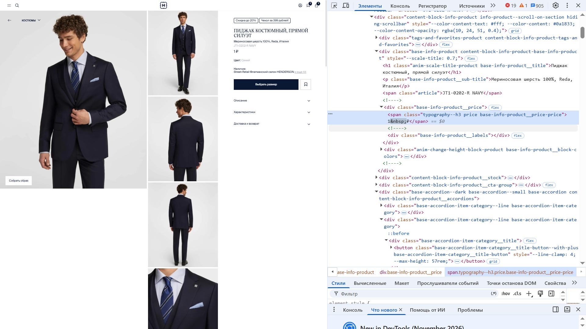
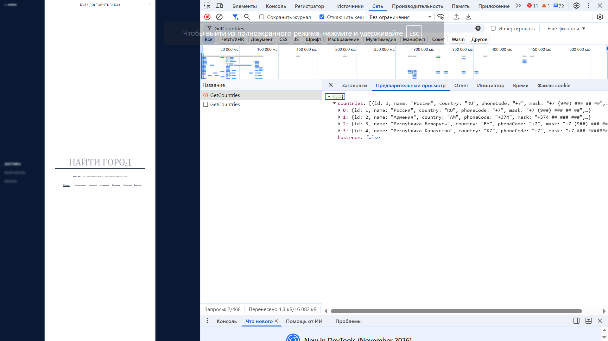

# Практические задания — Chrome DevTools

Практические работы по тестированию сайта HENDERSON, выполненные в рамках обучения.

## Задание 4. Проверка отображения граничных значений цены

**Цель:** проверить вёрстку карточки товара при минимальной и максимальной стоимости, указанной в техническом задании.

**Тестовые значения:**
- Минимальная цена — 1 ₽.
- Максимальная цена — 10 000 000 ₽.

**Инструмент:** Chrome DevTools, вкладка Elements.

С помощью DevTools изменяла отображаемую цену в HTML-элементе карточки товара и проверяла её отображение на странице.

**Скриншоты:**

## Задание 5. Анализ сетевого запроса GetCountries

**Цель:** найти запрос GetCountries и изучить данные, возвращаемые сервером.

**Инструмент:** Chrome DevTools, вкладка Network.

Выполненные действия:
1. Открыла DevTools и перешла во вкладку Network.
2. Нашла запрос `GetCountries`.
3. Открыла вкладку Preview (Предварительный просмотр).
4. Изучила структуру ответа с информацией о странах.

**Результат:** в ответе обнаружен массив `countries` с данными о странах и поле `hasError` со значением `false`.

**Скриншот:**

